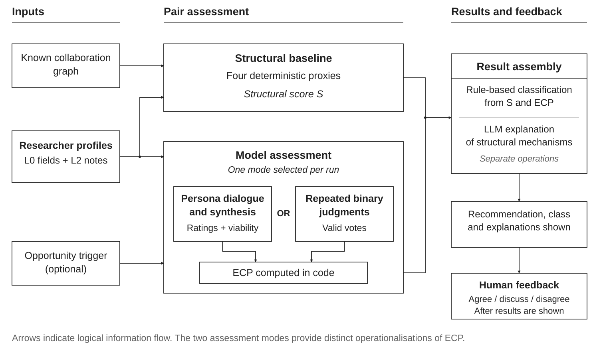
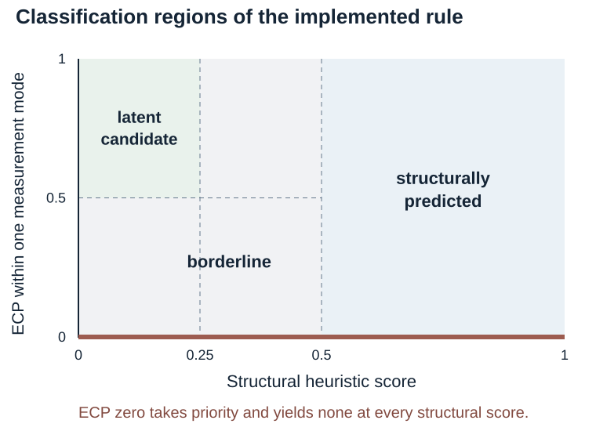
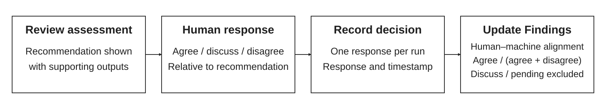

# WELCOME TO THE JUNGLE: AGENT ARENAS, UNLIKELY COLLABORATIONS, AND THE SEARCH FOR SCIENTIFIC IDEAS THAT MATTER

Technical appendix | Prototype ResearcherConnect v0.3 | Documentation revision 30 October 2026

**Repository** [ResearcherConnect on GitHub](https://github.com/romang99/my-agents-will-talk-to-yours)

**Inspected code revision** 92ed62e0c3be76a225aee626be11ae9823b63cf7

## Appendix overview

The overview links each section to the project documentation that supplies its detail. Document names identify files in the repository. The local reviewer walkthrough supplies the verification evidence summarised in A6.

| **Appendix section** | **Supporting project documents** |
| --- | --- |
| A1. System overview | TECHNICAL\_SPECIFICATION §§1–3; GLOSSARY |
| A2 Researcher representation | TECHNICAL\_SPECIFICATION §§5.3–5.4; DATA\_ETHICS §4 |
| A3 Producing ECP through two modes | DECISIONS Part 1 (10 September 2026), D12–D15; specs/2026-09-10 Part 2 |
| A4 Structural baseline and comparison | TECHNICAL\_SPECIFICATION §3; ARCHITECTURE “Baseline metrics” |
| A5 Human validation and evaluation measures | RESEARCH\_PROTOCOL §4 |
| A6 Study conditions and current status | RESEARCH\_PROTOCOL §3; STATUS §3; local reviewer walkthrough (28 October 2026) |
| A7 Implementation and reproducibility | ARCHITECTURE; WORKING\_WITH\_RUNS; CHANGELOG; DATA\_ETHICS |
| A8 Limitations and planned development | STATUS §3; TECHNICAL\_SPECIFICATION §10; DATA\_ETHICS §§6, 8; HANDOVER §3 |

## A1. System overview

ResearcherConnect supports the identification and assessment of potential research collaborations using researcher profiles, research opportunities and model judgments. It operationalises the paper's research design as a five-stage computational pipeline over a pool of researcher representations. The unit of analysis is the **researcher pair**; the unit of output is a **run** — a stored record of one model assessment of a pair and its comparison with the structural baseline.

**Definitions implemented.** Two numbers describe every pair. *Structural predictability* is a structural heuristic score combining proxies for the four tie-formation mechanisms of Dahlander & McFarland (2013), computed deterministically on \[0,1\]. *Expected collaboration potential* (ECP) is the system's own judgment of the pairing on \[0,1\], produced in one of two modes (§A3). A *latent collaboration opportunity* is operationalised as a run in which the structural score falls below a predefined threshold (0.25) and ECP reaches at least 0.5. This category identifies cases combining a low structural score with a positive model assessment of the proposed collaboration. Classification is applied in priority order: ECP of zero gives *none*; otherwise a structural score at or above 0.5 gives *structurally predicted*; otherwise a structural score below 0.25 with ECP at least 0.5 gives *latent*; all other cases are *borderline*. Classification is computed in code from the two numbers.

**Anchoring in an opportunity.** In the opportunity-anchored workflow, judgments refer to an explicit *trigger* — a call for papers, grant scheme or project brief supplied by the operator. The *trigger* provides a shared context for assessing collaboration potential. The *trigger* text is snapshotted into each run, preserving the context used for the assessment. An open-exploration condition with no *trigger* is retained for comparison.

**Figure 1. Implemented pair-assessment workflow.** Each run uses one model-assessment mode. Classification and structural explanation are separate operations, followed by presentation of the results and human feedback. Arrows indicate logical information flow.

## A2 Researcher representation

Each researcher is represented by a layered profile derived from the SyncMinds v0.1 mind-file format: **L0** stable identity (name, affiliations, unit, seniority, field, methods, interests, collaboration style) and **L2** dynamic reflections (recent reflective text, including researcher-supplied notes or AI-drafted material for review).

Profiles are composed deterministically into (i) a persona card shown in the interface for researcher verification and (ii) the text the models are given. Real researchers’ profiles are marked verified: false until the person reviews and confirms their own representation; an AI-drafted or AI-refreshed profile never sets that flag. The system includes a web-search scout that returns a profile draft with source URLs for human review. The intended protocol excludes unverified profiles from primary analysis; an automatic warning or block on live use of an unverified profile is not implemented in this release.

Private development encountered a fabricated publication in an AI-refreshed, unverified profile that subsequently entered a recommendation.

## A3 Producing ECP through two modes

The prototype implements two instruments for the model-assessment stage. Baseline, classification, interface feedback and run storage are shared, but the instruments differ in both procedure and the meaning of ECP. The second was adopted after limitations of the first became apparent in development.

**Conversation mode.** Two persona agents alternate for a fixed number of turns (default 6), each call carrying the speaker’s persona prompt, the trigger, the transcript so far, and phase guidance: relevance, assessment and judgment. Agents are instructed to practise recognition: judge whether a connection is worth making and state what each side would bring. The server passes the transcript between calls; these are represented roles and may use the same underlying model.

A synthesizer distils the transcript into a connection brief containing viable, title, fit\_summary, contributions, joint\_angle, first\_step, relevance, complementarity, feasibility and verdict. The three ratings r (relevance to the opportunity or, in open exploration, to both researchers' agendas), c (complementarity of their contributions) and f (feasibility of the proposed collaboration) use 1–5 scales. For a viable brief, the stored ECP is calculated in code as follows; a nonviable brief receives ECP zero.

$$
\mathrm{ECP}=\frac{(r-1)+(c-1)+(f-1)}{12}
$$

Subtracting 1 from each rating gives a maximum combined value of 12, which is used to normalise ECP to \[0,1\].

With the default six turns, a completed conversation run uses eight model calls: six turns, one synthesis and one assessor explanation. In private development, dialogue sometimes reached for facts absent from the profiles, invented details or stalled; the brief could repeat the conversation. A September 2026 prompt rewrite improved the register without resolving measurement validity. Historical runs on identical inputs also returned different ECP values. Individual live-run measurements are not distributed in this repository.

**Judge mode.** A model is shown both profiles and the trigger and asked whether the two researchers should collaborate on this opportunity, returning 0 or 1 and one sentence of reason. The question is repeated k times (default 10) for each of m models (default 3 Anthropic models). ECP is the share of valid votes in favour. Two prompt wordings are named experimental factors: unguided and guided, the latter asking the model to weigh complementarity over similarity. The full judge prompt is snapshotted into each run.

$$
\mathrm{ECP}=\frac{Y}{V}
$$

Y denotes positive votes and V valid votes. The implementation rounds both ECP instruments and the structural composite to three decimal places before classification. Conversation ratings are clamped to the 1–5 range; missing or nonnumeric ratings fall back to the lower bound.

Judge mode uses k × m + 1 model calls, including the assessor explanation. Its short responses are intended to reduce cost. Vote share describes model endorsement under the recorded configuration. Repeats and calculated averages reduce variability within the actual sampling process.

LLM judgments can align with human preferences in some evaluated tasks, while remaining sensitive to bias and evaluation design (Zheng et al., 2023). Transfer to research-collaboration assessment must be tested. ECP 0.5 means a mean rating of 3/5 in a viable conversation brief, but half positive votes in judge mode. The two modes must therefore be reported separately and assessed against common external criteria.

## A4 Structural baseline and comparison

The four mechanisms are computed deterministically from the collaboration graph and profile fields:

Table 1. Structural proxies in the inspected implementation. n denotes the researcher-pool size.

| **Mechanism** | **Implemented operationalisation** | **Range** |
| --- | --- | --- |
| Organisational foci | 0 for no shared institution; 0.6 for a shared institution; 1.0 for a shared unit within a shared institution. Multiple affiliations are compared as lists. | \[0,1\] |
| Status and value homophily | Equal-weight blend of seniority similarity, max(0, 1 − \|Δseniority\|/3), and Jaccard similarity of method-family sets; empty union yields 0. | \[0,1\] |
| Cumulative advantage | Geometric mean of the two graph degrees divided by n − 1; 0 when n ≤ 1. | \[0,1\] |
| Triadic closure | Shared-neighbour count divided by the smaller graph degree; 0 when either degree is 0, capped at 1. | \[0,1\] |

$$
S=0.30F+0.20H+0.20A+0.30T
$$

Here F denotes foci, H homophily, A cumulative advantage and T triadic closure. Weights and thresholds are named constants (WEIGHTS, THRESHOLDS). They are not preregistered as of this revision. The composite is interpreted as a structural heuristic. A robustness analysis can reclassify stored scores under alternative thresholds; alternative weights require retaining the per-mechanism scores, which the run records provide.

An assessor model produces per-mechanism natural-language explanations. The interface exposes the arithmetic for each pair: inputs, weighted contributions and total. The structural calculation and classification are deterministic; ECP and assessor prose remain model-dependent. The rule is applied in priority order: ECP zero gives none; otherwise S ≥ 0.5 gives predicted; otherwise S < 0.25 with ECP ≥ 0.5 gives latent; all other cases give borderline (Figure 2).

Figure 2. Decision regions of the current classification rule. The zero-ECP rule takes priority.

**Probing and sampling.** The interface ranks unconnected pairs by ascending structural score. This supports exploratory inspection. For a study of discrimination across structural proximity, use all eligible pairs where feasible or a sample stratified before observing model judgments. A study restricted to low-score pairs can support claims about that subset. Graph boundaries, missing ties and pool size must be recorded because they influence the scores.

## A5 Human validation and evaluation measures

**Implemented feedback.** Each completed run awaits a human decision — agree, worth discussing or disagree — with an optional note. The buttons are phrased against the machine recommendation, so “agree” denotes agreement with the recommendation in either direction. In judge mode, the human sees the one-sentence reasons; in conversation mode, the brief and transcript. The run stores one decision without a validator identity; it does not currently collect separate judgments from both represented people.

The interface computes **human–machine alignment** as agreements divided by agreements plus disagreements. “Worth discussing” is excluded from that denominator. The intended **beyond-baseline discovery** measure counts and reports the share of human-endorsed opportunities in the latent category. Reports must state denominators, missing responses, uncertain responses and whether the rater endorsed the recommendation or the collaboration itself.

The proposed evaluation would assess the scientific potential of suggested connections using predefined criteria, including thematic relevance, complementarity of perspectives and potential research contribution. The researchers’ personal willingness to collaborate would be recorded as a separate assessment.

**Figure 3. Implemented human-feedback workflow.** The user reviews the displayed assessment and records agreement, uncertainty or disagreement with the machine recommendation. One response and timestamp are stored per run. Human–machine alignment is calculated from agreement and disagreement responses; uncertain and unanswered runs are excluded.

**Proposed study design and evidence.** The proposed evaluation would examine how researcher representations and agent-mediated interaction support the development of promising scientific connections around a specific call. An initial exploratory phase would identify the information researchers consider relevant when evaluating a potential collaboration, including expertise, preferred contributions, current interests and availability. Researchers’ explanations of their assessments would inform targeted clarification questions and a shared evaluation rubric.

A first pilot would compare proposals generated from verified researcher profiles with proposals generated after a brief clarification round. The analysis would trace how additional information changes the proposed connection, the contributions attributed to each researcher and their assessment of the opportunity. A further development step would introduce short research sketches specifying a shared problem, a possible approach and the contribution of each researcher. Comparisons between agent-mediated exchange and a single AI system would use the same source material, output requirements and assessment criteria, with model resources and review time recorded.

Independent assessors would evaluate the sketches’ relevance to the call, scientific plausibility, originality and integration of the researchers’ contributions. Each represented researcher would separately assess the accuracy of their representation, the value of the proposed connection and their willingness to explore it. Participants would indicate whether the connection or research direction was already familiar, explain their assessment and suggest changes that would make the proposal more useful. These responses would help identify the criteria underlying acceptance and the role of opportunities to revise or challenge a proposal. The study would also record review effort and subsequent actions, such as agreeing to a conversation or developing the sketch further. Researchers, distinct pair–call cases and repeated model runs would be documented separately, and analyses would account for repeated assessments and researchers appearing in multiple pairs.

## A6 Study conditions and current status

The distributed seed pool contains 10 fictional synthetic researcher representations and 7 graph edges. No real-person representation is distributed. It includes a deliberately distant disciplinary profile for exercising a negative-result path; that fixture is not a validated scientific gold standard. Two stored offline examples illustrate the run schema, not empirical collaboration outcomes.

As documented on 28 October 2026, no formal study condition had been run. Historical private development exposed test–retest variability and possible over-endorsement or limited sampling variation in judge mode. Individual live-run values and records remain outside the shared repository. The evidence below distinguishes engineering checks from substantive evaluation.

Table 2. Evidence status of the inspected prototype and the existing local reviewer walkthrough.

| **Evidence or capability** | **Status and interpretation** |
| --- | --- |
| Offline software tests | 56 tests passed in the local reviewer walkthrough on 28 October 2026. This supports the tested computations and workflow, not scientific validity. |
| Publishing check | Passed in that walkthrough. Shared fixtures contain fictional profiles and offline outputs; live-person data and live runs remain private. |
| Synthetic  interface walkthrough | Both modes completed, feedback persisted and negative outcomes were reachable. The provider was a deterministic offline driver, with no LLM inference. |
| Live model behavior | Private development observations are documented; no formal study results or public live-run dataset are claimed. |
| Anthropic API provider | Implemented but not exercised live in the documented development state. |
| Team formation and arena | Not implemented. Arena mechanisms remain future development. |

Candidate study factors remain trigger versus open exploration, profile depth, judge-prompt wording and assessment mode. Empirical outcome counts, rates and measured costs will be reported after data collection with their denominators and study conditions.

## A7 Implementation and reproducibility

**Stack.** Node.js ≥ 20; no build step; one optional dependency (@anthropic-ai/sdk). The frontend uses vanilla ES modules with a custom canvas force layout. The project is distributed under the included MIT licence.

**Models and access.** A provider abstraction supports the Anthropic API, the local Claude Code CLI and a deterministic offline demo driver used by the test suite. Live use requires the operator’s own authenticated access. Provider, model, mode and judge-prompt variant are recorded per run. Another vendor requires an additional driver and testing; it is not part of this release.

**Provenance.** Every run persists as a JSON artifact containing the trigger snapshot, baseline breakdown, persona cards, turns or votes with timestamps, brief or judgments, assessment, stage log and human decision. docs/WORKING\_WITH\_RUNS.md describes the format. The judge saves its full prompt. Conversation runs do not save all prompt texts or their versions; exact reconstruction requires the matching code revision. Future study records should retain an explicit revision and prompt identifier. The project's own genesis (idea email, meeting transcript, plan) and the working-session transcripts that redirected the design are preserved; `docs/DECISIONS.md` is the dated decision log.

**Offline reproduction.** At the inspected revision, run npm test and npm run check:publishing, then npm run demo. The demo uses templated outputs without model credentials and is suitable for examining the workflow. Live outputs require separately configured model access and must not be pooled with demo records. Record Node and provider versions, model identifiers, sampling settings actually supported by the provider, profile and graph snapshots, call text, prompt version and run IDs for any empirical condition.

**Tests and experiment boundaries.** Offline tests cover deterministic metrics, classification thresholds, explanation/score consistency, pool composition, both pipeline modes, negative-result paths, resumability, vote parsing and ECP, scout parsing, routing and archive/reset behavior. Clearing findings archives runs and a manifest instead of deleting them, keeping prior conditions recoverable.

**Data governance.** Shared materials contain fictional seed profiles and offline examples only. Real profiles, corrections and live runs remain in a separately governed private study workspace. LLM processing sends profile and conversation content to the configured external provider; local JSON storage does not eliminate that transfer. Consent, provider arrangements, retention and withdrawal must be settled before participant study use. Profile verification is currently a boolean; timestamped verification, participant access to all relevant runs and automated withdrawal from historical run records remain open implementation work.

## A8 Limitations and planned development

**1. Representation validity.** Judgments are a function of profiles and trigger alone; an unverified profile can carry fabricated or stale claims into a recommendation, as happened once in development. Verification before use is a validity condition. Further information may be needed to improve the basis for assessing proposed collaborations. Planned extensions include targeted follow-up questions to researchers, further opportunities for researchers to revise and enrich their representations, and analysis of richer data sources.

**2. Discriminant validity.** Model agreement can reflect yes-bias rather than discrimination. Evaluate verified suitable and poor-fit pairs, compare prompt conditions, and measure human endorsement in the separate private study.

**3. Sampling variance.** Repeats only estimate a distribution if sampling is stochastic; the CLI path appears near-deterministic. The study should use the API path with explicit sampling parameters and report test–retest.

**4. Judges are not independent.** Three models from one vendor share training; agreement among them is weak evidence. Cross-vendor judges address this.

**5. Tie leakage through profile text.** Reflections and notable work name collaborators, so a judge can see the tie the baseline is meant to measure independently. Either collaborator names are stripped from judge prompts or this is reported as a confound. Further work will examine the relationships represented in the system and the information used to establish and characterise them. The extent to which recommendations should favour similarity or complementary differences, and under which conditions, remains an open design question.

**6. Small-world baseline.** With a ten-node seed graph, cumulative advantage and triadic closure have limited variance; institutional-scale data (QUT Pure) is the intended remedy.

**7. Construct gap.** ECP is a model judgment, not ground truth; human validation is the corrective, and misalignment is itself data. Further development aims to align model assessments more closely with users’ evaluations of proposed collaborations.

**8. The trigger is itself a focus.** Anchoring in a call for papers introduces exactly the kind of organisational focus the baseline measures — but one that did not exist socially. Whether this is a contribution (agents as synthetic foci) or a limitation is open. Future work will explore ways of initiating interaction in the system beyond direct contact between researchers. These may include thematic connections and complementary research or career orientations that help reveal connections beyond existing collaboration circles.

**9. Independent validation is required.** Development feedback does not replace a study with independent validators who are blind to condition. The study will examine the criteria and reasons users draw on when accepting proposed collaborations and judging them to be promising.

## References

Dahlander, L., & McFarland, D. A. (2013). Ties that last: Tie formation and persistence in research collaborations over time. *Administrative Science Quarterly, 58*(1), 69–110. [DOI 10.1177/0001839212474272](https://doi.org/10.1177/0001839212474272)

Zheng, L., Chiang, W.-L., Sheng, Y., Zhuang, S., Wu, Z., Zhuang, Y., Lin, Z., Li, Z., Li, D., Xing, E. P., Zhang, H., Gonzalez, J. E., & Stoica, I. (2023). Judging LLM-as-a-Judge with MT-Bench and Chatbot Arena. *Advances in Neural Information Processing Systems, 36*, 46595–46623. [DOI 10.52202/075280-2020](https://doi.org/10.52202/075280-2020)

### Project materials

Implementation and development observations are grounded in the inspected revision and its technical, protocol, status, handover and data-governance documents. Offline verification refers to the local walkthrough of 28 October 2026. The accompanying proposal defines the broader scientific vision.

[Artifact revision 92ed62e0c3be](https://github.com/romang99/my-agents-will-talk-to-yours/tree/92ed62e0c3be76a225aee626be11ae9823b63cf7)   |   [Organization Science call](https://orgsci.org/)
